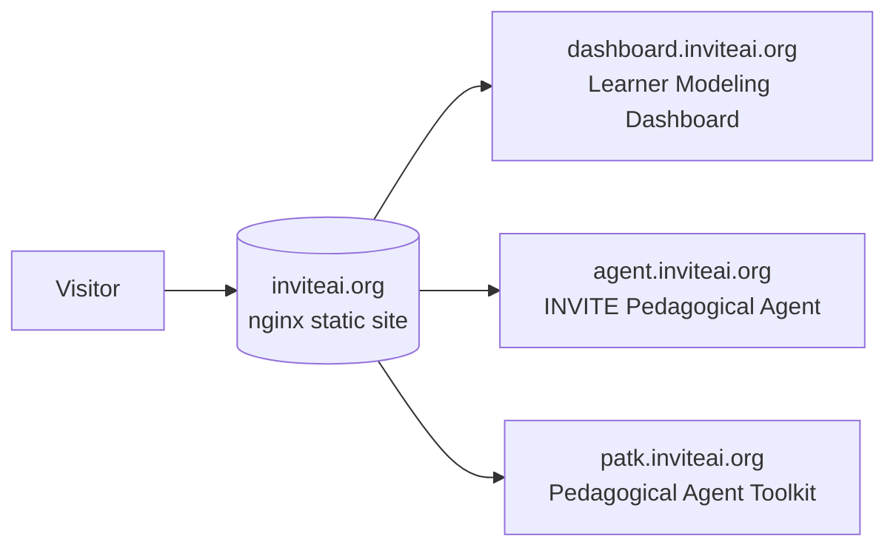

# INVITE Research Software Website

This repository is the public landing page at <https://inviteai.org>. The page shows the research
software that the **INVITE Institute** (the NSF-IES National AI Institute for Innovative
Intelligent Technologies for Education) builds and runs. It is one hand-written static page. The
page lists these tools:

- The Learner Modeling Dashboard
- The INVITE Pedagogical Agent
- The Pedagogical Agent Toolkit

A sticky rail on the left holds each tool's Open button, and a large screenshot of each tool with a
short description fills the right. The header and footer match the
[INVITE Institute](https://invite.illinois.edu/) site.



## Files

| Path | What |
|---|---|
| `public/` | the web root that nginx serves, and the only folder it serves |
| `public/index.html` | the page markup and its small script |
| `public/styles.css` | the stylesheet, with the design tokens at the top |
| `public/assets/` | self-hosted fonts and images, copied from the invite.illinois.edu theme and uploads |
| `DESIGN.md` | the design tokens and components |
| `PRODUCT.md` | who the page is for, and the product facts that design work must respect |

There is no build step. To preview the page, serve the folder and open <http://localhost:8080>.

```bash
python3 -m http.server 8080 --directory public
```

## Deploy

A push to `main` deploys the site. The `invite-web-deploy` webhook resets `/var/www/invite-web` to
`origin/main`, and nginx serves the new files right away. The nginx site config lives in
InviteInstitute/infra at `files/etc/nginx/sites-available/inviteai.org`. The origin is behind
Cloudflare, so a hard refresh may be needed to see an image change, since `/assets/` is cached for
an hour.
