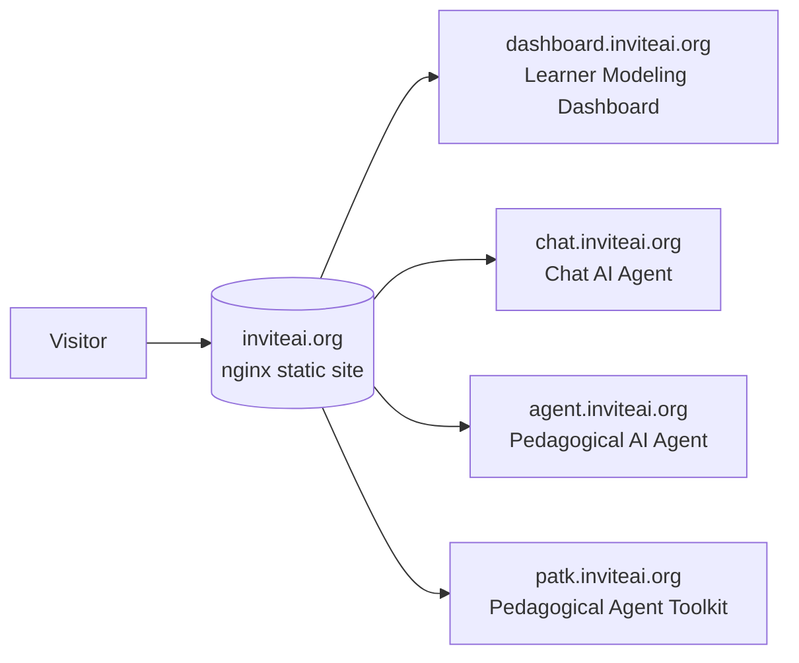

# INVITE Research Software Website

This repository is the public landing page at <https://inviteai.org>. The page shows the research
software that the **INVITE Institute** (the NSF-IES National AI Institute for Innovative
Intelligent Technologies for Education) builds and runs. It is one hand-written static page. The
page lists these tools:

- The Learner Modeling Dashboard
- The Chat AI Agent
- The Pedagogical AI Agent
- The Pedagogical Agent Toolkit

Each tool has a short description and a live or coming-soon badge. Each tool links to where it
runs.



## Quick Start

The site has no build step, and you do not need to install anything. The site is plain static
files:

- `public/index.html` holds the markup.
- `public/styles.css` holds the styles.
- `public/assets/` holds the self-hosted fonts and images.

To preview the site, serve the folder. The stylesheet and relative paths then behave exactly as
they do in production.

```bash
python3 -m http.server 8080 --directory public   # then open http://localhost:8080
```

Edit `public/index.html` or `public/styles.css`. Then refresh the page to see the change.

## What You Get

- The look of the wider [INVITE Institute](https://invite.illinois.edu/) site. The page uses the
  fonts, colors, lined title bar and footer of its TheGem theme, so the page reads as part of that
  site.
- A **tool list**. Each tool has a name, a one-line description, a **Live** badge, and a button
  that opens the tool on its own subdomain.
- A screenshot of each running tool, on alternating sides.
- A links band that points to the source code of the tools and to the pages of the Institute.
- The Institute footer, with the NSF and IES funding disclaimer (Grant #2229612), partner logos and
  social links.

## Layout

| Path | What |
|---|---|
| `public/` | the web root that nginx serves, with everything public |
| `public/index.html` | the page markup |
| `public/styles.css` | the stylesheet, with the design tokens at the top |
| `public/assets/` | self-hosted fonts and images, copied from the invite.illinois.edu theme and uploads |
| `PRODUCT.md` | who the page is for, and the product facts that design work must respect |
| `LICENSE` | project license |

Anything outside `public/` (this README, `LICENSE`, the `.git` history) is above the web root.
Nginx never serves it.

## Serving It Remotely

Production uses plain nginx to serve the static folder. There is no application process. The site
config sets its root to `public/` and serves `index.html`.

```nginx
server {
    server_name inviteai.org www.inviteai.org;
    root /var/www/invite-web/public;
    index index.html;

    location / {
        try_files $uri $uri/ =404;
    }
    # TLS via Certbot, HTTP redirects to HTTPS
}
```

A push to `main` deploys the site. The `invite-web-deploy` webhook resets `/var/www/invite-web` to
`origin/main`. Nginx uses the new files immediately, so content changes need no reload. Reload nginx only if you change the site config. The origin is
behind Cloudflare, so you may need a hard refresh or a cache purge to see a change right away.

## Under the Hood

The site is deliberately minimal: static HTML and CSS, with no framework, no bundler and no
runtime. The markup is in `index.html`, and the styles are in `styles.css`. These plain files are
easy to read, edit, review in a diff, and deploy.

Each tool that the page links to has its own repository:
[lm-dashboard](https://github.com/InviteInstitute/lm-dashboard),
[vex-chat-agent](https://github.com/InviteInstitute/vex-chat-agent),
[vex-pedagogical-agent](https://github.com/InviteInstitute/vex-pedagogical-agent), and the
Pedagogical Agent Toolkit. This repository is only the front door.
